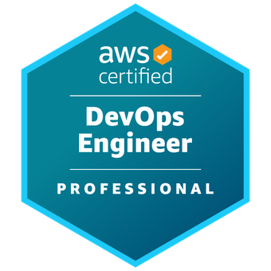
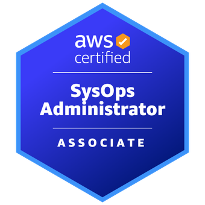
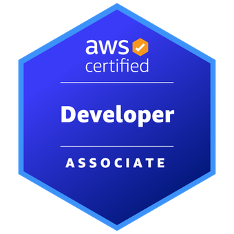
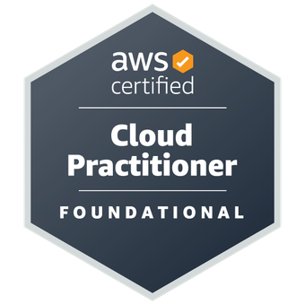
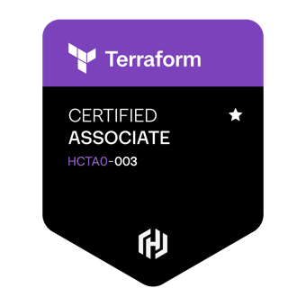

### Hi, I'm John Ed Manauis 👋

**DevOps Engineer · Cloud & Observability** · Philippines

I'm a DevOps Engineer at EasyEquities, working on AWS cloud infrastructure, Kubernetes and observability with Grafana, Loki and Prometheus. I started in IT support and network and system administration, then moved into software engineering at Accenture and on to DevOps.

---

#### 🛠️ Toolbox

#### 🏅 Certifications

#### 📌 Featured

| Project | What it is |
|---|---|
| [**Grafana**](https://github.com/neo64347/Grafana) | Terraform for an observability stack on AWS ECS Fargate: Grafana, Prometheus, Loki and Alloy behind an ALB |
| [**portfolio-manauis**](https://github.com/neo64347/portfolio-manauis) | My portfolio site ([live](https://neo64347.github.io/portfolio-manauis/)) |
| [**e-ctmsarcgis**](https://github.com/neo64347/e-ctmsarcgis) | Bootcamp mini project: dashboard web app with an ArcGIS 3D map and Messenger chat |
| [**e-ml.io**](https://github.com/neo64347/e-ml.io) | Bootcamp mini project: E-MedLearning, a health-education site |
